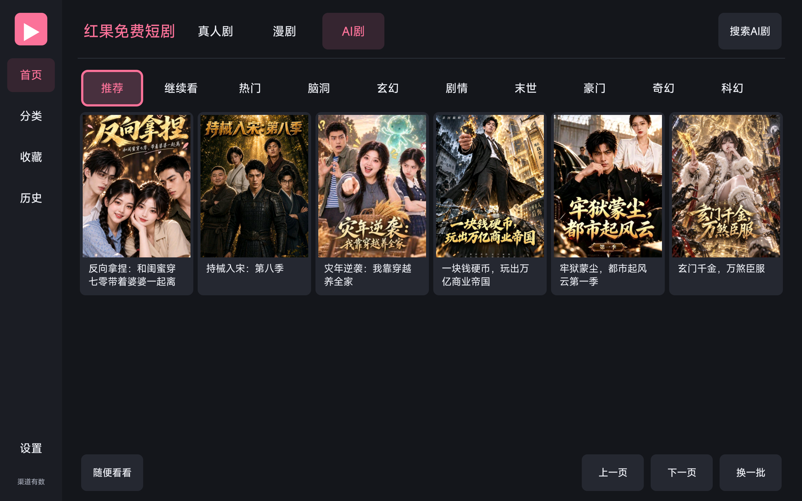
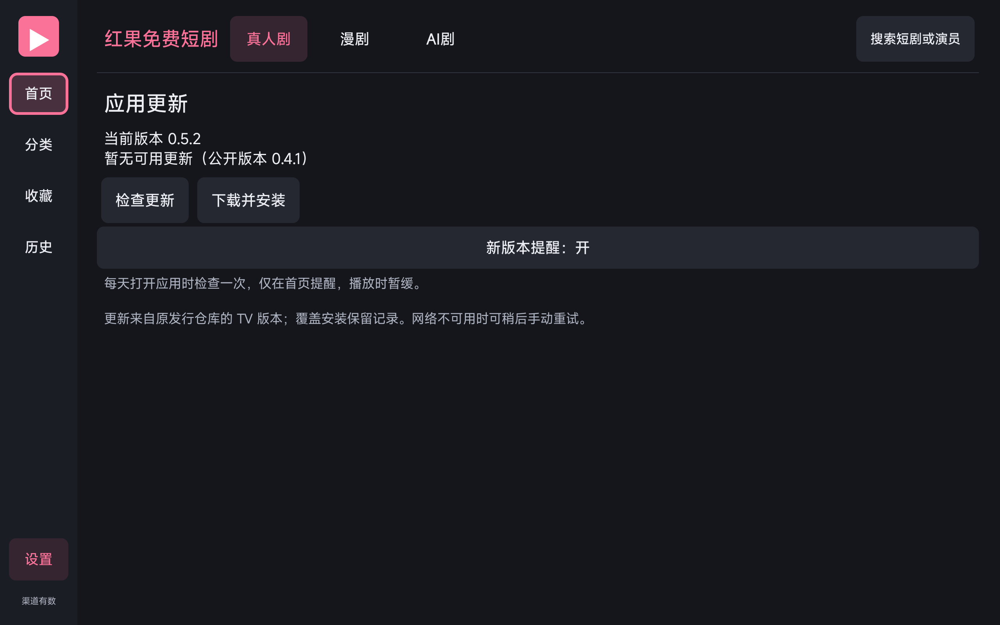

# 红果电视端：用遥控器看短剧，不喜欢就换一部

由 **渠道有数** 独立维护 · 免费使用 · **0.5.5 测试版**

**[下载 APK · 4.08 MB](https://github.com/waligoraamodio288-rgb/hongguo-desktop-releases/releases/download/tv-v0.5.5/HongguoTV-0.5.5-arm64.apk)**　｜　[发行说明与原版校验](https://github.com/waligoraamodio288-rgb/hongguo-desktop-releases/releases/tag/tv-v0.5.5)　｜　[反馈设备体验](https://github.com/waligoraamodio288-rgb/hongguo-desktop-releases/issues/new?template=android-tv.yml)

适用于 **Android 5.0+、ARM64 系统**的电视、盒子、投影和平板。仅 CPU 为 64 位而系统为 32 位的设备暂不支持；真实电视、旧固件和实体遥控仍待测试。

## 0.5.5 首页与分类恢复

恢复真人剧首页、题材浏览和快速换剧的片单获取；真人剧、漫剧、AI 剧各用对应分类，缓存与取消处理保持轻量。原“近期”入口改为“全部”，不把缺少上线时间的剧目当成新剧。保留0.5.4的播放资源修复。

小米 Android 13 平板已验证0.5.5首页选剧与换剧实播；2026-10-14补验三类片单和真实后台解码通过。**关键词搜索仍可能受原服务影响；AI搜索只筛选当前热门片单。搜索不可用时请从首页或题材分类选剧。本版仍只支持ARM64系统。**

## 看剧时少按几次键

- 不用开电脑：电视版独立播放；暗色界面支持方向键、确认与返回操作。

- 不喜欢就“换一部”：充分观看后优先同题材，首集主动换剧时尝试其他题材，并给近期候选更高权重。推荐根据本机观看行为调整，可在设置中关闭或重置。

- 找到喜欢的剧：搜索、收藏、续播、选集和自动连播；支持画面比例、快进退与定时停止。倍速需要 Android 6.0+。

- 面向小内存设备控制开销：原生界面、系统播放器，低内存模式海报缓存 2 MiB、首页每页4张海报；更新采用分块下载，无后台常驻服务。实际流畅度仍取决于机型、固件和片源，不承诺所有旧电视都能正常播放。

*0.5.1 小米 Android 13 平板 AI 首页实拍，0.5.2 沿用该布局并新增在线更新；剧目封面归各自权利方所有，非实物电视验收。*

*0.5.2 更新页实拍于发布前，截图中的公开0.4.1是当时状态。当前版本以本文下载入口和发行页为准。*

## 保留的功能

- 顶部真人剧、漫剧、AI 剧与题材分类，片单直接显示；缓存分类立即复用。

- 全屏或进度条长按确认临时2倍，松开恢复原速（Android6+）。

- 每天使用时检查更新，仅首页提醒，播放暂缓；可稍后、忽略或关闭提醒。

- 设置 → 关于与帮助 → 检查更新；下载可取消，原版签名与摘要校验后交系统确认。

**0.5.2～0.5.4可在应用内检查并下载0.5.5；0.5.1及以前需手动覆盖安装一次，之后可收到新版提醒。**

## 三步安装

1. 下载上面的 `HongguoTV-0.5.5-arm64.apk`。确认是 Android 系统且支持 ARM64；不确定时可查询设备系统信息或在反馈表中写明型号。

2. 用 U 盘或设备支持的文件传输方式把 APK 放到设备上，在文件管理器中点开安装。按设备正常提示授权本次安装；若设备策略禁止安装，请记录提示原文，不需要关闭整机安全防护。

3. 打开应用，用方向键选择剧集并确认播放。在播放栏选择“换一部”“选集”或“设置”；已有同签名版本可覆盖升级，保留本机记录。

[更详细的安装与帮助](https://channel-ai-practice-wj.waligoraamodio288.chatgpt.site/help/install/#android-tv)

## 安装前常见问题

| 问题 | 当前情况 |

| --- | --- |

| 电脑必须开着吗？ | 不需要，电视版可以独立运行。 |

| 能同步电脑的收藏和进度吗？ | 暂不能，各设备分别保存收藏、历史和偏好。 |

| 支持所有旧电视吗？ | 不保证。最低要求 Android 5.0+ / ARM64；32 位系统和非 Android 系统不适用。 |

| 显示无法安装怎么办？ | 记录设备型号、Android 版本和完整提示，先核对系统架构。不要反复卸载已有可用版本。 |

| 能安装但无法播放怎么办？ | 记录加载、黑屏或报错现象，以及换一部剧是否相同。上游目录、片源和网络都可能影响播放。 |

| 是官方客户端吗？ | 不是。本项目与红果官方无隶属关系。 |

## 欢迎反馈真实设备体验

目前已在小米 M2105K81AC / Android 13 平板验证安装、播放和推荐交互。电视、盒子与投影的实际使用情况需要逐台记录。

无论能否正常使用，都可以填[电视版反馈表](https://github.com/waligoraamodio288-rgb/hongguo-desktop-releases/issues/new?template=android-tv.yml)：设备型号、Android 版本、能否安装、实体遥控、首播音画及续播。没有测试的项目可以跳过；无需提交账号、密码或个人观看历史。

分享时请保留 **渠道有数**署名与[原发行链接](https://github.com/waligoraamodio288-rgb/hongguo-desktop-releases/releases/tag/tv-v0.5.5)。应用“设置 → 关于与帮助”可以核对来源。想在电脑上看，可下载 [Windows 版](https://github.com/waligoraamodio288-rgb/hongguo-desktop-releases/releases/latest)。
